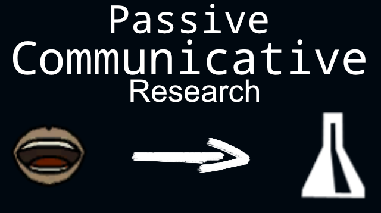

# Passive Communicative Research

A Rimworld mod that allows pawns to generate passive research points for projects while they're interacting with each other.

### Details

Whenever two pawns talk to each other, they will roll for a chance to discuss a research project.

The Intellectual, artistic, and social stats of both pawns combined is then added to a random research project that is available to the colony. If a research project is already selected, the mod will lean towards progressing that project first before looking at other projects.

If the pawn is already at a research bench while they're talking to another pawn, the effect of that conversation if tripled.

If the pawn is in a bad mood, nothing will happen. However, if they're in a exceptional mood, the points will be doubled.

